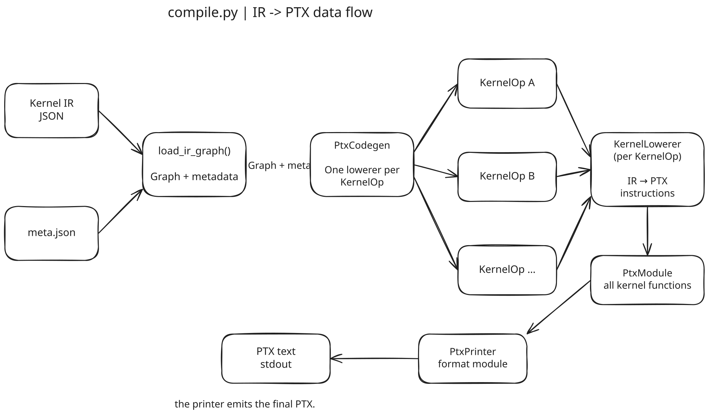

# Emmy Kernel IR to PTX

This project is a submission for [emmy-hackathon-2026](https://github.com/cloudrift-ai/emmy-hackathon-2026). It implements an Emmy Kernel IR to PTX compiler for a subset of Kernel IR operations and lowers them directly to PTX.

## Run the compiler

Requirements:

```bash
pip install emmy-ml==0.3.11 numpy requests
```

```bash
python compile.py path/to/kernel.ir.json > out.ptx
```

or

```bash
python submit.py <problem_id> --compiler compile.py
```

Generate custom inputs

```bash
EMMY_DUMP_DIR=out emmy compile -c "<torch expr>" --ir kernel
```

## Core design

The compiler lowers Emmy's scheduled kernel operations directly to PTX.

The following is an overview:

```mermaid
classDiagram
    direction TB

    class KernelLowerer {
        +graph: Graph
        +ir_kernel: KernelOp
        +func: PtxFunction
        +regs: RegisterStore
        +params: list[FuncParam]
        +add_instr(opcode, operands, predicate)
        +plan_shared_memory()
        +__init__(graph, params, ir_kernel)
        +lower() PtxFunction
        -lower_body(body)
        -lower_stmt(stmt)
    }

    class Graph {
        <<input>>
    }
    class KernelOp {
        <<input>>
        +name: str
        +body
        +smem_buffers
    }

    class PtxFunction {
        +name: str
        +params: list[FuncParam]
        +registers: RegisterStore
        +instructions: list[PtxInstr or PtxLabel]
        +label_count: int
        +shared: dict[str, SharedMemory]
        +dynamic_shared: bool
        +shared_align: int
        +new_label(name) PtxLabel
        +add_label(label)
        +add_instr(opcode, operands, predicate)
    }

    class RegisterStore {
        +reg_counts: dict[PtxRegisterType, int]
        +bindings: dict[str, Register]
        +new(reg_type, varname) Register
        +bind(name, register)
        +get_reg(name) Register
        +scope()
    }
    class Register {
        +name: str
        +type: PtxRegisterType
    }

    class FuncParam {
        +name: str
        +type: PtxRegisterType
        +pointee_type: PtxRegisterType or None
    }
    class SharedMemory {
        +name: str
        +nbytes: int
        +align: int
        +offset: int
    }
    class PtxInstr {
        +opcode: str
        +operands: tuple
        +predicate: Predicate or None
    }
    class PtxLabel {
        +name: str
    }
    class Predicate {
        +reg: Register
        +negated: bool
    }

    Graph ..> KernelLowerer : input
    KernelOp ..> KernelLowerer : input
    KernelLowerer *-- PtxFunction : creates and returns
    PtxFunction *-- RegisterStore : owns
    PtxFunction o-- FuncParam : parameters
    PtxFunction o-- PtxInstr : emitted instructions
    PtxFunction o-- PtxLabel : labels in instruction stream
    PtxFunction o-- SharedMemory : planned regions
    RegisterStore o-- Register : named bindings
    PtxInstr --> Predicate : optional guard
    Predicate --> Register : tests

    note for KernelLowerer "lower() calls prologue(), then lower_body(ir_kernel.body), emits ret, and returns func.<br/>- lower_body() visits each child node.<br/>- lower_stmt() dispatches by node type to the corresponding lowering logic.<br/>- Nested blocks call lower_body() again, so statement traversal is recursive."
```




## Implementation checklist

- [x] **1. Pointwise:** `Tile`, `Load`, `Assign`, `Write`.
- [x] **2. Reductions:** `StridedLoop`, `Accum`, `WarpShuffle`, `Smem`, `Sync`, `TreeHalve`.
- [x] **3. Matmul:** `Loop`, `Init`, `CpAsyncCopy`, `CpAsyncCommit`, `CpAsyncWait`, atomic `Write`.
- [ ] **4. Fused.**
- [ ] **5. Attention-like.**

## Type support and instruction selection

The lowerer keeps Emmy `DataType` separate from PTX register types. `memory_types()` maps supported types to storage/register pairs: `i16` to `s16`/`s32`, `f16` to `b16`/`f16`, and `bool` to `u8`/`s32`. `lower_load()` turns loaded booleans into predicates; `lower_write()` stores them as `0` or `1`. `buffer_address()` selects global or shared memory, while `memory_operands()` emits scalar, `.v2`, or `.v4` accesses.

For `Assign`, `lower_assign()` starts from the result type. `lower_elementwise()` calls `numeric_type()` for add, subtract, multiply, minimum, and maximum. It promotes small integers and predicates to `s32`, and `f16` to `f32`; wider integers and `f32`/`f64` keep their type. It converts operands with `coerce()`, emits the operation, then converts the result back.

Expressions use `lower_binary()` and `coerce_binary()`: logical ops go through `as_pred()`, shifts promote the left value and use a `u32` shift count, and other pairs go through `coerce_pair()`. That helper picks `f64`, then `f32`, or the widest integer type, unsigned when a widest-width operand is unsigned. It converts both operands before opcode selection. `TernaryExpr` uses it to match branch types.

`coerce()` emits conversions: float-to-integer rounds toward zero; integer-to-float and float narrowing round to nearest. `as_pred()` tests for nonzero and uses an unordered float comparison so NaN is true. `lower_binary()` then selects typed instructions, such as `mul.lo.s32`, `mul.f32`, or `setp.lt.f64`.

Some `lower_elementwise()` ops always use `f32`: `divide`, `exp`, `reciprocal`, `relu`, and `sqrt`. `exp` uses `mul.f32` and `ex2.approx.f32`. An `Assign` divide with `f64` inputs loses precision before widening; a `BinaryExpr` divide can use `div.rn.f64`. `WarpShuffle` accepts mapped register types `f32`, `s32`, `u32`, `f64`, `s64`, and `u64`. It splits 64-bit values into two 32-bit words because PTX shuffle moves 32-bit lanes.
